# Use Cases

> **Status:** Draft proposed by the agent. Every use case is `Draft`. They only restate behavior already in the functional requirements (FR) and add the order of interactions; they add no new requirement. Where a flow suggests something the FR do not say, it is marked **Proposal** and needs an Owner decision.
>
> Sequence diagrams use the components of [components](../../04-design/components.md): Screens (CMP-001), Data store (CMP-002), Calculator (CMP-003), Scheduler (CMP-004), Notifier (CMP-005), System events (CMP-006), Backup (CMP-007), External actions (CMP-008), Permissions (CMP-009). The primary actor of every case is the **Landlord**, except UC-015, which the Android system starts.

| UC | Name | Objective | FR |
|----|------|-----------|----|
| UC-001 | Register a property | OBJ-001 | FR-001 · FR-002 · FR-003 |
| UC-002 | Register a tenant | OBJ-001 | FR-004 · FR-005 |
| UC-003 | Create a rental | OBJ-001 · OBJ-003 | FR-007 · FR-008 · FR-013 · FR-023 · FR-024 |
| UC-004 | See this week's collections | OBJ-002 | FR-015 · FR-016 · FR-017 |
| UC-005 | Browse the calendar | OBJ-002 | FR-014 |
| UC-006 | Receive a reminder | OBJ-003 | FR-018 · FR-020 · FR-021 · FR-022 · NFR-004 |
| UC-007 | Contact the tenant | OBJ-004 | FR-025 · FR-026 |
| UC-008 | Edit a rental | OBJ-001 | FR-009 · FR-010 |
| UC-009 | End a rental | OBJ-001 | FR-011 |
| UC-010 | Delete a rental | OBJ-001 | FR-012 |
| UC-011 | Delete a tenant | OBJ-001 | FR-006 |
| UC-012 | Choose reminder offsets and time | OBJ-003 | FR-018 · FR-019 |
| UC-013 | Export a backup | OBJ-005 | FR-027 |
| UC-014 | Import a backup | OBJ-005 | FR-028 · FR-029 · NFR-005 |
| UC-015 | Rebuild reminders after an event | OBJ-003 | FR-021 · FR-022 · ADR-0003 |

---

### UC-001 — Register a property
- **Status:** Draft
- **Primary actor:** Landlord
- **Origin:** FR-001 · FR-002 · FR-003
- **Preconditions:** none.
- **Postconditions:** the property exists and can be linked to a rental.

**Main flow**
1. The landlord opens the properties list and chooses to add a property.
2. The landlord types the name and, optionally, a description.
3. The landlord saves. The property appears in the list as free.

**Alternative flows and exceptions**
- 2a. The name is empty: saving is refused with a message (AC-FR-001-2).
- Editing follows the same screens (FR-002). There is no delete action (FR-003).

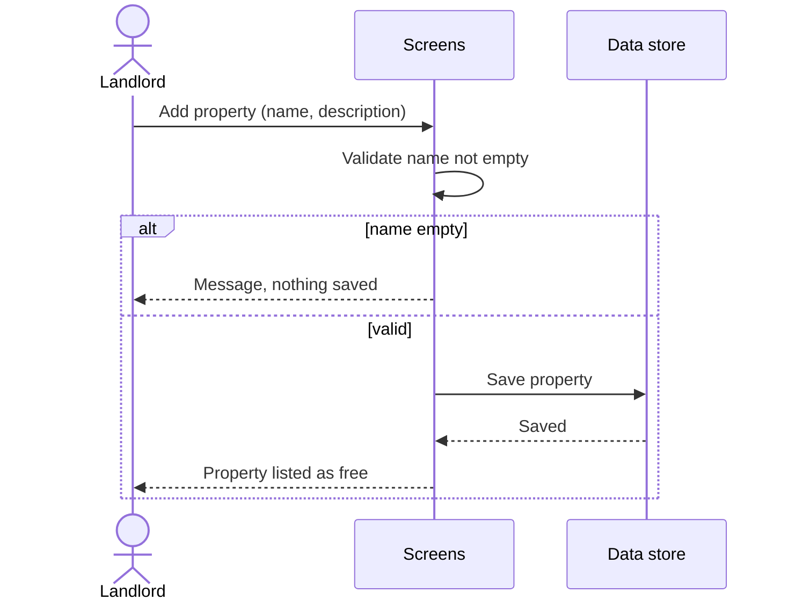

---

### UC-002 — Register a tenant
- **Status:** Draft
- **Primary actor:** Landlord
- **Origin:** FR-004 · FR-005
- **Preconditions:** none.
- **Postconditions:** the tenant exists and can be linked to a rental.

**Main flow**
1. The landlord opens the tenants list and chooses to add a tenant.
2. The landlord types the full name and, optionally, a phone number.
3. The landlord saves. The tenant appears in the list.

**Alternative flows and exceptions**
- 2a. The name is empty: saving is refused (AC-FR-004-2).
- A tenant with an active rental can be edited at any time (AC-FR-005-1).

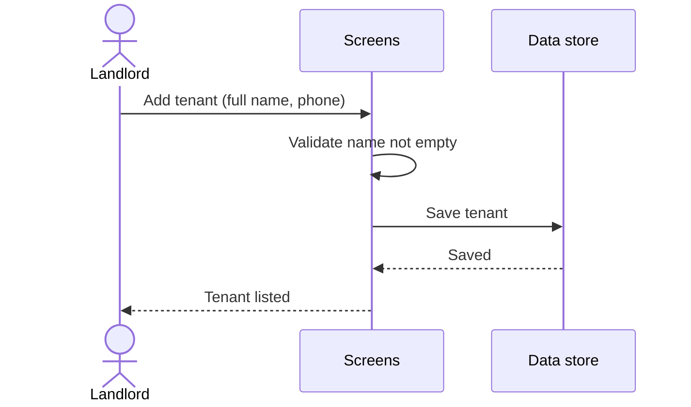

---

### UC-003 — Create a rental
- **Status:** Draft
- **Primary actor:** Landlord
- **Origin:** FR-007 · FR-008 · FR-013 · FR-023 · FR-024
- **Preconditions:** at least one tenant and one property exist.
- **Postconditions:** the rental exists; its collections appear in the calendar and the weekly summary; reminders are scheduled.

**Main flow**
1. The landlord chooses to create a rental.
2. The landlord picks a tenant and a property, and types the amount in colones and the payment day (1 to 31). An end date is optional.
3. The system checks that neither the tenant nor the property has an active rental, and saves in one transaction.
4. If this is the first rental, the system explains why it needs two permissions and asks for the notification permission and for the exact-alarm permission (FR-023).
5. The scheduler builds the reminders.
6. The landlord sees the rental, with its next collection date.

**Alternative flows and exceptions**
- 3a. The property or the tenant has an active rental: the rental is refused with a message (AC-FR-008-1, AC-FR-008-2). **Proposal:** show occupied properties and busy tenants as unavailable in the pickers, so the error is prevented instead of reported afterwards; the refusal stays as the safeguard.
- 2a. Amount zero, negative or not whole, or an end date in the past: refused (AC-FR-007-2, AC-FR-007-3).
- 4a. A permission is denied: the rental is kept and a visible warning says reminders may not arrive on time (FR-024).

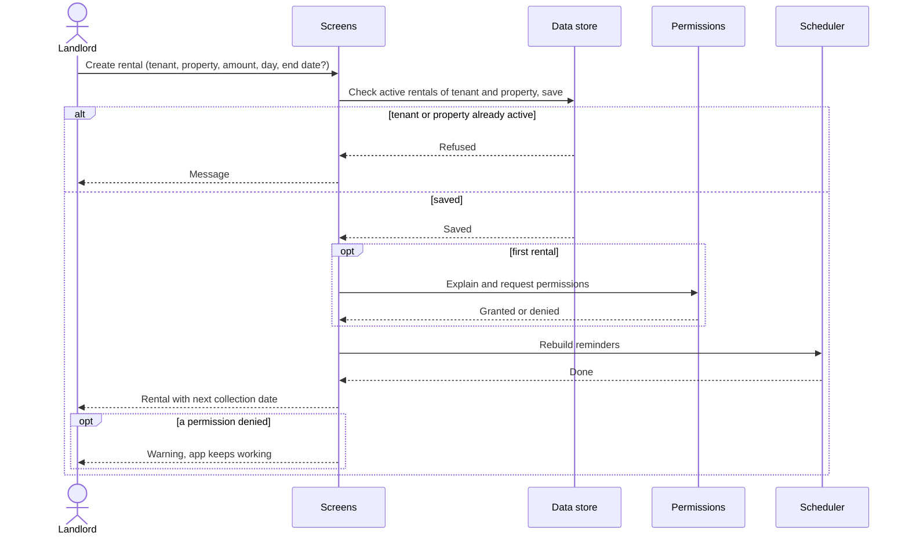

---

### UC-004 — See this week's collections
- **Status:** Draft
- **Primary actor:** Landlord
- **Origin:** FR-015 · FR-016 · FR-017
- **Preconditions:** none; an empty week shows an empty state.
- **Postconditions:** none; read only.

**Main flow**
1. The landlord opens the app. The weekly summary shows the current week, Monday to Sunday.
2. Each entry shows property, tenant, date and amount, and the week shows its total.
3. The landlord moves to the previous or the next week to look, and no further.

**Alternative flows and exceptions**
- Opening the app again always returns to the current week (AC-FR-016-1).
- The summary shows no statuses such as paid or overdue (FR-015).

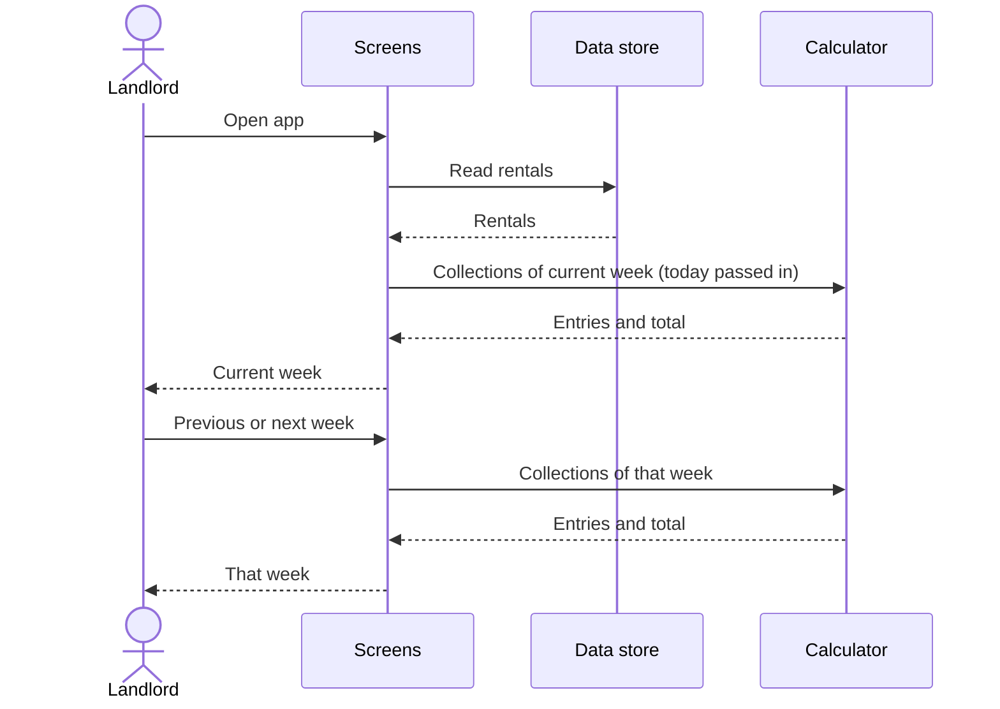

---

### UC-005 — Browse the calendar
- **Status:** Draft
- **Primary actor:** Landlord
- **Origin:** FR-014
- **Preconditions:** none.
- **Postconditions:** none; read only.

**Main flow**
1. The landlord opens the calendar. Today and later dates with collections are marked.
2. The landlord selects a date and sees the collections of that day with their amounts.

**Alternative flows and exceptions**
- Dates before today show nothing (AC-FR-014-2). No statuses are shown (AC-FR-014-3).

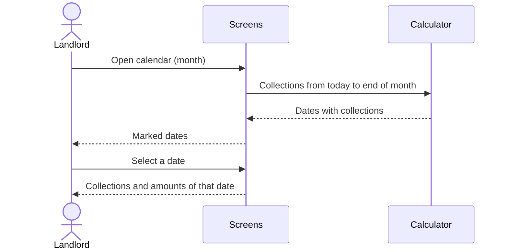

---

### UC-006 — Receive a reminder
- **Status:** Draft
- **Primary actor:** Landlord
- **Origin:** FR-018 · FR-020 · FR-021 · FR-022 · NFR-004
- **Preconditions:** a rental exists; reminders were scheduled; permissions granted for on-time delivery.
- **Postconditions:** the landlord has been told of the collection.

**Main flow**
1. At the chosen time of an enabled offset (3, 2, 1 days before, or the same day) the system fires the alarm.
2. The notifier shows a notification with property, tenant, amount and due date.
3. The landlord taps it. The app opens on the current week.

**Alternative flows and exceptions**
- 2a. Notifications are off: nothing is shown (verified on the Owner phone, ADR-0003). The warning of FR-024 exists to prevent this.
- The last scheduled reminder of a window is the renewal reminder, which asks the landlord to open the app (FR-022). Opening the app rebuilds the window (UC-015).
- After a force stop, reminders are lost until the app is opened (RSK-001).

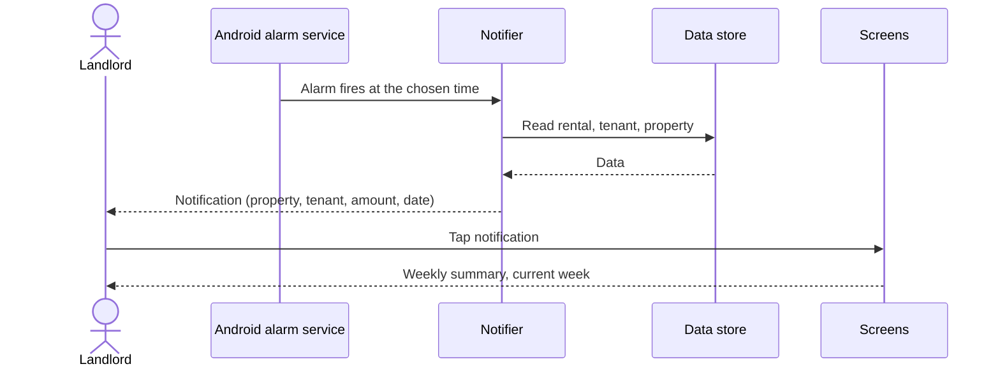

---

### UC-007 — Contact the tenant
- **Status:** Draft
- **Primary actor:** Landlord
- **Origin:** FR-025 · FR-026
- **Preconditions:** the tenant of a rental has a phone number.
- **Postconditions:** an external app is open on that number.

**Main flow**
1. From a rental, the landlord chooses WhatsApp or Call.
2. The system opens the external app on the tenant's number. The landlord sends the message or places the call there.

**Alternative flows and exceptions**
- 1a. No phone number: the actions are disabled or hidden (AC-FR-025-2, AC-FR-026-2).
- 2a. WhatsApp is not installed: not specified in the FR. **Proposal:** show a message saying so. Needs an Owner decision (OI-043 covers only the number format).

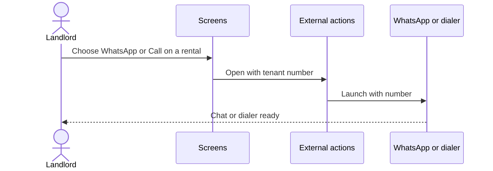

---

### UC-008 — Edit a rental
- **Status:** Draft
- **Primary actor:** Landlord
- **Origin:** FR-009 · FR-010
- **Preconditions:** the rental exists.
- **Postconditions:** the new values apply from the next reminder; future reminders are recalculated.

**Main flow**
1. The landlord opens a rental and chooses to edit it.
2. The landlord changes the amount, the payment day or the end date. The tenant and the property cannot be changed (FR-009).
3. The landlord saves. The scheduler rebuilds the reminders.
4. The calendar and the weekly summary show the new dates.

**Alternative flows and exceptions**
- 2a. Invalid values are refused as in UC-003.

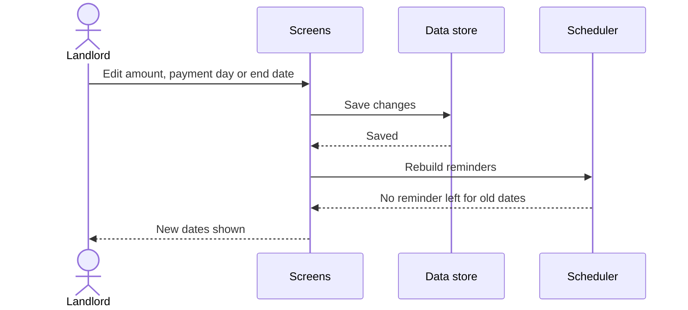

---

### UC-009 — End a rental
- **Status:** Draft
- **Primary actor:** Landlord
- **Origin:** FR-011
- **Preconditions:** the rental is active.
- **Postconditions:** no collections or reminders after the end date; the property is free; the record is kept.

**Main flow**
1. The landlord opens the rental and sets its end date.
2. The system saves it and rebuilds the reminders.
3. After the end date the property shows as free and can be used in a new rental (AC-FR-008-3).

```mermaid
sequenceDiagram
    actor L as Landlord
    participant S as Screens
    participant D as Data store
    participant R as Scheduler
    L->>S: Set end date
    S->>D: Save end date
    S->>R: Rebuild reminders
    R-->>S: None after end date
    S-->>L: Rental ending; property free after the date
```

---

### UC-010 — Delete a rental
- **Status:** Draft
- **Primary actor:** Landlord
- **Origin:** FR-012
- **Preconditions:** the rental exists.
- **Postconditions:** the rental and its pending reminders are gone; tenant and property remain.

**Main flow**
1. The landlord chooses to delete a rental.
2. The system asks for confirmation, stating the action cannot be undone.
3. After confirming, the rental is deleted and the reminders rebuilt.

**Alternative flows and exceptions**
- 3a. The landlord cancels: nothing changes (AC-FR-012-1).

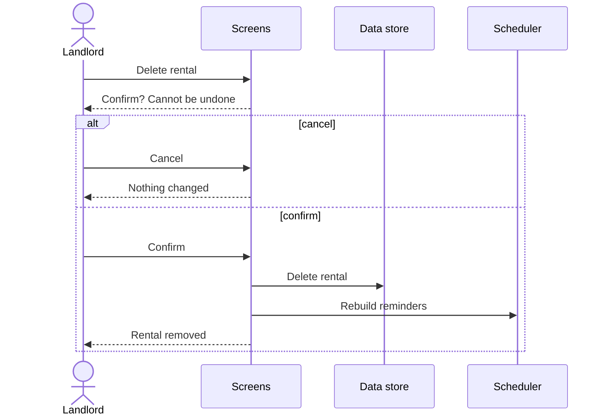

---

### UC-011 — Delete a tenant
- **Status:** Draft
- **Primary actor:** Landlord
- **Origin:** FR-006
- **Preconditions:** the tenant exists.
- **Postconditions:** the tenant, all their rentals (active or ended) and their pending reminders are gone; properties remain and are free.

**Main flow**
1. The landlord chooses to delete a tenant.
2. The system asks for confirmation, stating how many rentals will be deleted and that it cannot be undone (AC-FR-006-1).
3. After confirming, everything is deleted in one transaction and the reminders rebuilt.

**Alternative flows and exceptions**
- 3a. The landlord cancels: nothing is deleted (AC-FR-006-2).

```mermaid
sequenceDiagram
    actor L as Landlord
    participant S as Screens
    participant D as Data store
    participant R as Scheduler
    L->>S: Delete tenant
    S->>D: Count the tenant's rentals
    D-->>S: N rentals
    S-->>L: Confirm? N rentals will be deleted, cannot be undone
    alt cancel
        S-->>L: Nothing deleted
    else confirm
        S->>D: Delete tenant and rentals (one transaction)
        S->>R: Rebuild reminders
        S-->>L: Done; properties free
    end
```

---

### UC-012 — Choose reminder offsets and time
- **Status:** Draft
- **Primary actor:** Landlord
- **Origin:** FR-018 · FR-019
- **Preconditions:** none.
- **Postconditions:** pending reminders match the new choices.

**Main flow**
1. The landlord opens the reminder settings.
2. The landlord turns each offset (3, 2, 1 days before, same day) on or off and picks one time of day.
3. The system saves and rebuilds the reminders.

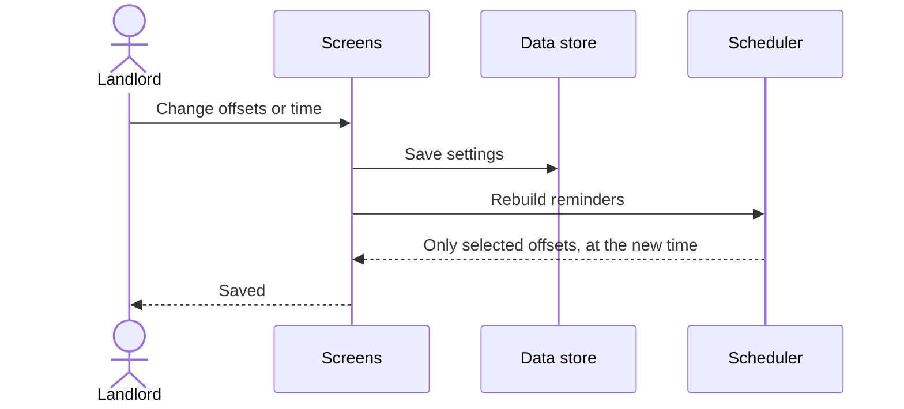

---

### UC-013 — Export a backup
- **Status:** Draft
- **Primary actor:** Landlord
- **Origin:** FR-027
- **Preconditions:** none.
- **Postconditions:** a JSON file was offered to the share menu.

**Main flow**
1. The landlord chooses to export.
2. The system warns that the file contains personal data in plain text (AC-FR-027-1).
3. After accepting, the system builds the file (ADR-0004) and opens the share menu.
4. The landlord picks the destination.

**Alternative flows and exceptions**
- 2a. The landlord cancels at the warning: no file is created.

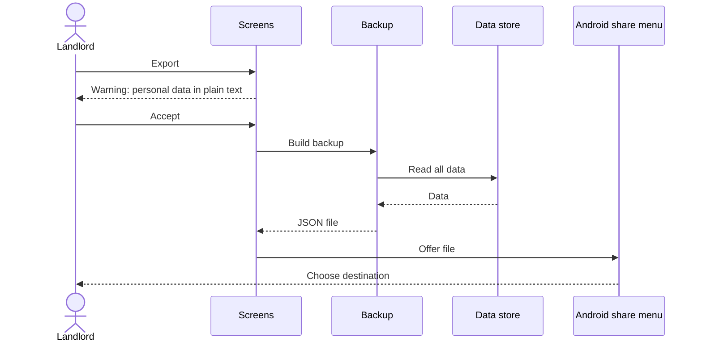

---

### UC-014 — Import a backup
- **Status:** Draft
- **Primary actor:** Landlord
- **Origin:** FR-028 · FR-029 · NFR-005 · ADR-0004
- **Preconditions:** the landlord has a backup file.
- **Postconditions:** all data equals the file and reminders are rebuilt, or nothing changed.

**Main flow**
1. The landlord chooses to import and picks the file.
2. The system reads and validates it completely before touching any data (ADR-0004).
3. The system asks for explicit confirmation that current data will be lost.
4. After confirming, the system replaces all data in one transaction and rebuilds the reminders.

**Alternative flows and exceptions**
- 2a. Not valid, unknown or newer version: rejected with a message, data unchanged (FR-029).
- 3a. The landlord cancels: data unchanged (AC-FR-028-1).
- 4a. Failure during replacement: rolled back (NFR-005).

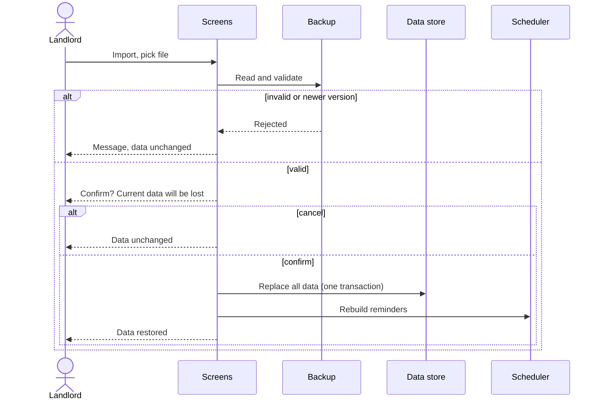

---

### UC-015 — Rebuild reminders after an event
- **Status:** Draft
- **Primary actor:** Android system (on behalf of the landlord)
- **Origin:** FR-021 · FR-022 · ADR-0003
- **Preconditions:** rentals exist.
- **Postconditions:** the nearest reminders are scheduled and no stale reminder remains.

**Main flow**
1. One of these events happens: the app is opened, the phone finishes booting and is unlocked, or the exact-alarm permission changes.
2. The scheduler computes the nearest reminders from the rentals and the settings, up to the window limit, plus the renewal reminder.
3. It cancels the previous alarms and creates the new ones.

**Alternative flows and exceptions**
- 3a. The exact-alarm permission is missing: inexact alarms are used and the warning of FR-024 is shown.
- After a force stop nothing runs until the app is opened (verified, ADR-0003).
- After a reboot the rebuild happens only after the first unlock (verified, ADR-0003).

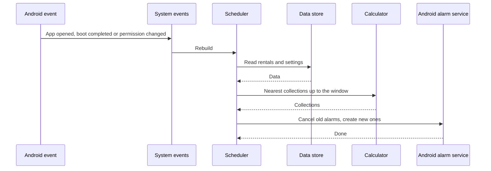

## Refs
OBJ-001 to OBJ-005 · FR-001 to FR-029 · NFR-004 · NFR-005 · CMP-001 to CMP-009 · ADR-0003 · ADR-0004 · RSK-001 · OI-043
